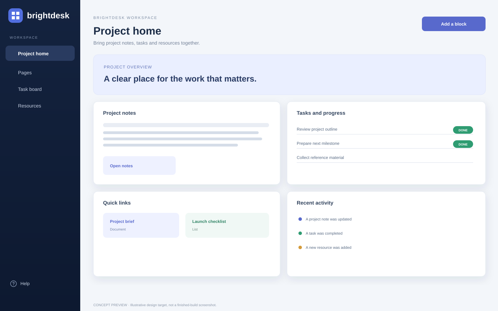

# Brightdesk Workspace

 <strong>brightdesk</strong>

<strong>Bring project notes, tasks and resources together.</strong>

> **Visual example:** This is the proposed Brightdesk Workspace experience. It is a design concept, not a screenshot of a finished application.

## Shared Brightdesk design standard

The planned product follows the [Brightdesk visual and interaction standard](https://github.com/connormolloy12/Brightdesk-suite/blob/main/docs/BRIGHTDESK_VISUAL_STANDARD.md) for branding, icon usage, layout, responsive behaviour and accessibility.

## Product experience

Brightdesk Workspace is planned as a local-first project home that connects pages, notes, checklists and resources in one organised place.

## Planned capabilities

- Create workspaces, pages and project areas.
- Add and organise content blocks.
- Connect notes, tasks and resources within a project.
- Show useful project context and recent activity.
- Keep project information on this device.

## Implementation status

**Repository scaffold only.** This repository contains product design assets and documentation, but no runnable application source, package manifest, automated app tests or desktop installer. Do not treat the concept preview as a working app.

## Design brief

See [docs/DESIGN_BRIEF.md](docs/DESIGN_BRIEF.md) for planned screens, navigation and acceptance targets.

## Related project

[Brightdesk Office Suite](https://github.com/connormolloy12/Brightdesk-suite)

## Professional workspace examples and acceptance

Workspace should feel like a useful project home, not a second generic launcher. Its purpose is to bring related pages, notes, tasks and resources into one coherent project context.

### Example workflow

1. Create a project workspace with a clear name and description.
2. Add a project note, a task/checklist and a resource link.
3. Organise the material into a small number of meaningful sections.
4. Open an item and return to the project without losing context.
5. Reopen the workspace and verify its structure is retained.

Use a clear project navigation hierarchy, a readable central work area and restrained contextual panels. Show relationships between project material without implying that separate applications are deeply connected unless that integration exists and is tested.

Follow the shared [Brightdesk visual and interaction standard](https://github.com/connormolloy12/Brightdesk-suite/blob/main/docs/BRIGHTDESK_VISUAL_STANDARD.md).

### Acceptance checks

- Workspace navigation and project context remain consistent while moving between items.
- Content blocks and linked resources have clear, accessible actions.
- Persistence and cross-module integration are verified before being claimed.
- Scaffold status is not confused with a runnable application.
